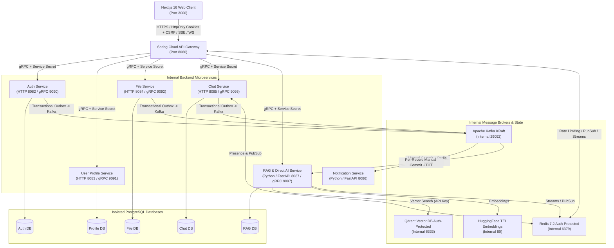

# AI Learning Platform

A distributed AI learning and research platform featuring asynchronous retrieval-augmented generation (RAG), multi-format document extraction with OCR, direct multi-provider LLM execution with durable worker leases, `HttpOnly` cookie + CSRF authentication, transactional outbox event publishing, and real-time WebSocket and Server-Sent Events (SSE) streaming.

---

## 1. Architectural Overview & System Design

The platform combines Java 21 / Spring Boot 3 microservices for transactional domains and edge security, Python FastAPI / gRPC services for AI orchestration, document ingestion, and notifications, and a Next.js 16 / React 19 web client.

### High-Level Architecture Diagram



---

## 2. Technology Stack & Service Responsibilities

### Service Catalog

| Service | Technology | Internal Ports | Default Host Port | Primary Responsibilities |
| :--- | :--- | :--- | :--- | :--- |
| **frontend** | Next.js 16, React 19, TypeScript, Tailwind CSS | 3000 | 3000 | Workspace UI with persisted tabs/split panes, safe Markdown/DOCX rendering, real-time chat, Direct AI |
| **api-gateway** | Spring Cloud Gateway, WebFlux, Netty | 8080 | 8080 | Public edge ingress, RSA JWT validation (with key rotation), `HttpOnly` cookie & CSRF enforcement, Redis rate limiting, WS/SSE streaming |
| **auth-service** | Spring Boot 3, Java 21, JPA, Flyway | 8082 (HTTP), 9090 (gRPC) | Private* | Registration, BCrypt auth, RS256 JWT issuance, refresh token rotation, transactional outbox |
| **user-profile-service** | Spring Boot 3, Java 21, JPA, Flyway | 8083 (HTTP), 9091 (gRPC) | Private* | Profile CRUD, visibility controls, search, idempotent Kafka bootstrap |
| **file-service** | Spring Boot 3, Java 21, JPA, Flyway | 8084 (HTTP), 9092 (gRPC) | Private* | File/folder CRUD, sharing ACLs, streaming binary storage, transactional outbox |
| **chat-service** | Spring Boot 3, Java 21, JPA, Flyway, Redis | 8085 (HTTP), 9095 (gRPC) | Private* | Chatrooms, messages, typing indicators, transactional outbox, Kafka DLT error handling |
| **notification-service** | Python 3.12, FastAPI, `smtplib`, Redis | 8086 (HTTP) | Private* | Manual-commit Kafka verification email consumer, persistent Redis/SQLite deduplication, confirmed DLQ publishing |
| **rag-service** | Python 3.12, FastAPI, SQLAlchemy, Alembic, gRPC | 8087 (HTTP), 9097 (gRPC) | Private* | Multi-format extraction (PDF/DOCX/XLSX/PPTX/images+OCR), Qdrant retrieval, bounded multi-instance worker leases, `MultiFernet` key rotation |

\* Internal ports are not published in the base `docker-compose.yml`. Use `docker-compose.dev.yml` to bind debugging ports strictly to `127.0.0.1`.

### Shared Infrastructure

| Component | Image | Security Posture | Role |
| :--- | :--- | :--- | :--- |
| **PostgreSQL** | `postgres:15-alpine` | Unique required credentials per service; internal-only | Dedicated relational datastore per microservice (Flyway / Alembic managed) |
| **Redis** | `redis:7.2-alpine` | `--requirepass` required; internal-only | Rate limiting, Redis Streams/PubSub for SSE & WS, notification deduplication |
| **Kafka (KRaft)** | `confluentinc/cp-kafka:7.5.0` | Internal listener only by default | Asynchronous domain event bus + dead-letter topics |
| **Qdrant** | `qdrant/qdrant:v1.12.4` | `QDRANT__SERVICE__API_KEY` required; internal-only | Vector storage and similarity search |
| **TEI** | `text-embeddings-inference:cpu-1.5` | Internal-only | Local CPU embedding inference (`BAAI/bge-large-en-v1.5`) |

---

## 3. Repository Structure

```text
AI-Learning-Platform/
├── .env.example                     # Environment template (all required secrets documented)
├── SECURITY.md                      # Security architecture, secret injection & key rotation guide
├── docker-compose.yml               # Hardened production-default Compose stack
├── docker-compose.dev.yml           # Local development override (127.0.0.1 debug ports, HTTP cookies)
├── scripts/
│   └── generate-dev-keys.sh         # Generates local RSA-2048 JWT keys under ./secrets/
├── backend/
│   ├── proto/                       # Shared Protocol Buffer contracts
│   ├── api-gateway/                 # Spring Cloud Gateway edge service
│   ├── auth-service/                # Identity, RSA JWT signing & transactional outbox
│   ├── user-profile-service/        # User profiles & idempotent registration consumer
│   ├── file-service/                # File/folder storage, ACLs & transactional outbox
│   ├── chat-service/                # Chatrooms, messages & transactional outbox
│   ├── notification-service/        # Email worker with manual commits & Redis deduplication
│   └── rag-service/                 # Document ingestion, Alembic migrations, Qdrant & Direct AI
└── frontend/
    ├── app/                         # Next.js 16 App Router pages
    ├── src/                         # Components, contexts, hooks, API client, sanitization
    ├── eslint.config.mjs            # ESLint 9 flat config
    ├── vitest.config.ts             # Vitest unit/regression test config
    └── Dockerfile                   # Non-root multi-stage production container (npm ci)
```

---

## 4. Quick Start

### Prerequisites
- Docker Engine 24.0+ and Docker Compose v2.20+
- OpenSSL (for generating local JWT RSA keys)
- Host RAM: 8 GB minimum (16 GB recommended when running local TEI embeddings)

### Local Development Setup

1. **Generate local RSA JWT signing keys** (written to git-ignored `./secrets/`):
   ```bash
   ./scripts/generate-dev-keys.sh
   ```

2. **Configure environment variables:**
   ```bash
   cp .env.example .env
   ```
   Edit `.env` and populate all required secrets (database passwords, `REDIS_PASSWORD`, `QDRANT_API_KEY`, `APP_GRPC_*_SERVICE_SECRET`, `AI_KEY_ENCRYPTION_SECRET`, and at least one LLM provider key such as `GEMINI_API_KEY`, `GROQ_API_KEY`, `DEEPSEEK_API_KEY`, `OPENAI_API_KEY`, or `OPENROUTER_API_KEY`).

3. **Start the local development stack** (binds debug ports strictly to `127.0.0.1` and enables HTTP cookies for `http://localhost:3000`):
   ```bash
   docker compose -f docker-compose.yml -f docker-compose.dev.yml up --build
   ```

4. **Access the application:**
   - **Web Application:** `http://localhost:3000`
   - **API Gateway:** `http://localhost:8080/api`
   - **Gateway Health / Readiness:** `http://localhost:8080/actuator/health/readiness`
   - **Gateway Metrics:** `http://localhost:8080/actuator/prometheus`

### Production Deployment

1. Provision RSA keys (`jwt_private_key.pem`, `jwt_public_key.pem`) via your secret manager and mount them at `/run/secrets/` (or configure `JWT_PRIVATE_KEY_FILE` / `JWT_PUBLIC_KEY_FILE`).
2. Set `APP_ENV=production`, `APP_AUTH_COOKIE_SECURE=true`, HTTPS `NEXT_PUBLIC_API_URL` / `GATEWAY_ALLOWED_ORIGINS`, and strong unique values for all secrets in `.env` or your orchestrator environment.
3. Run using **only** the base hardened Compose file (internal database, broker, and microservice ports are not exposed):
   ```bash
   docker compose up -d --build
   ```

See [SECURITY.md](SECURITY.md) for key rotation, CSRF protection, encryption rotation, and hardening details.

---

## 5. Key Endpoints & Operational Probes

### Streaming & Realtime Endpoints
- **Direct AI Execution SSE:** `GET /api/ai/executions/{executionId}/stream`
- **Chat AI Message SSE:** `GET /api/chat/messages/{messageId}/stream`
- **Chat WebSocket:** `WS /ws/chat` (authenticated via `HttpOnly` cookie or `Sec-WebSocket-Protocol` bearer header)
- **Session & CSRF Bootstrap:** `GET /api/auth/session`, `GET /api/auth/csrf`

### Liveness, Readiness & Metrics
- **Java Services (`api-gateway`, `auth`, `profile`, `file`, `chat`):**
  - `GET /actuator/health/liveness`
  - `GET /actuator/health/readiness`
  - `GET /actuator/prometheus`
- **Python Services (`rag-service` :8087, `notification-service` :8086):**
  - `GET /health` (liveness)
  - `GET /ready` (readiness verifying Postgres/Qdrant/Redis/Kafka)
  - `GET /metrics` (Prometheus metrics)

### Destructive Volume Cleanup Warning

> [!CAUTION]
> `docker compose down -v` permanently deletes all PostgreSQL databases, Redis data, Qdrant vector indices, and uploaded files. Use only for a full reset.

---

## 6. Testing & Verification

### Java Microservices (Maven / Java 21)
```bash
for svc in auth-service api-gateway file-service chat-service user-profile-service; do
  mvn -B -f backend/$svc/pom.xml test
done
```

### Python `rag-service`
```bash
cd backend/rag-service
ruff check app tests
pytest -v
```

### Python `notification-service`
```bash
cd backend/notification-service
ruff check app tests
pytest -v
```

### Frontend (Next.js 16 / Vitest / ESLint)
```bash
cd frontend
npm ci
npm run typecheck
npm run lint
npm test
npm run build
```

---

## 7. License

This project is licensed under the **MIT License** — see [LICENSE](LICENSE).
Third-party attributions are documented in [THIRD_PARTY_LICENSES.md](THIRD_PARTY_LICENSES.md).
