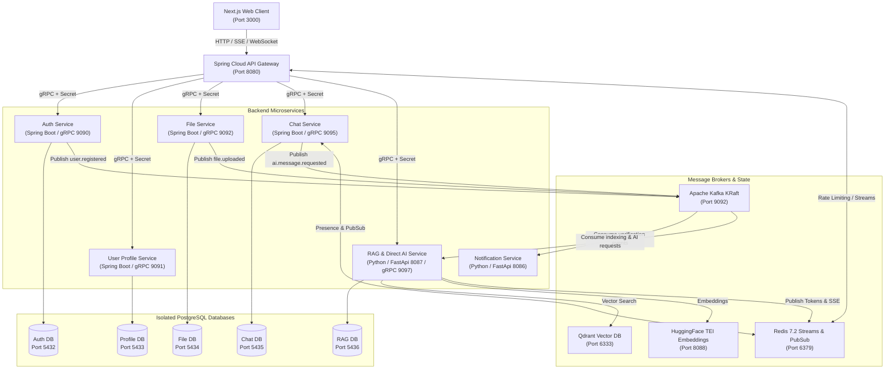

# AI Learning Platform

An enterprise-grade, distributed AI learning and research platform featuring asynchronous retrieval-augmented generation (RAG), direct multi-provider LLM execution, persistent job queue recovery, secure real-time WebSocket and Server-Sent Events (SSE) streaming, and event-driven microservices.

---

## 1. Architectural Overview & System Design

The AI Learning Platform is architected as an event-driven, microservices-based ecosystem combining high-performance Java Spring Boot services for transactional integrity and business domain isolation, asynchronous Python services for AI orchestration and vector retrieval, and a modern Next.js client interface.

### High-Level Architecture Diagram



---

## 2. Technology Stack & Service Responsibilities

### Service Catalog

| Service | Technology | Internal Port | External Port | Primary Responsibilities |
| :--- | :--- | :--- | :--- | :--- |
| **frontend** | Next.js 14, React 19, TypeScript, Tailwind | 3000 | 3000 | Responsive web application, real-time chat, AI studio, document browser |
| **api-gateway** | Spring Cloud Gateway, WebFlux, Netty | 8080 | 8080 | Single entry point, JWT validation, IP rate limiting, prompt sanitization, WS/SSE routing |
| **auth-service** | Spring Boot 3, Java 21, Spring Security, JPA | 9090 | 9090 | RBAC authorization, registration, password hashing (BCrypt), JWT issuance |
| **user-profile-service** | Spring Boot 3, Java 21, JPA | 9091 | 9091 | User profile management, biographical data, user preferences |
| **file-service** | Spring Boot 3, Java 21, JPA | 9092 | 9094 | File storage, multipart upload validation, file metadata persistence |
| **chat-service** | Spring Boot 3, Java 21, Redis, JPA | 9095 | 9095 | Chatrooms, message persistence, typing indicators, read receipts |
| **notification-service** | Python 3.12, FastAPI, aiosmtplib | 8086 | 8086 | Asynchronous email delivery, verification codes, Kafka consumer |
| **rag-service** | Python 3.11, FastAPI, SQLAlchemy, gRPC | 8087, 9097 | 8087, 9097 | Document chunking, hybrid vector search, LLM routing, durable execution queue |

### Shared Infrastructure

| Component | Image / Engine | Host Port | Role |
| :--- | :--- | :--- | :--- |
| **PostgreSQL** | `postgres:15-alpine` | 5432-5436 | Dedicated relational database instances per microservice |
| **Redis** | `redis:7.2-alpine` | 6379 | Token bucket rate limiting, Redis Streams for SSE, real-time presence |
| **Kafka (KRaft)** | `confluentinc/cp-kafka:7.5.0` | 9092 | High-throughput asynchronous event bus across domain microservices |
| **Qdrant** | `qdrant/qdrant:v1.12.4` | 6333, 6334 | Vector search engine for document embeddings and similarity retrieval |
| **TEI** | `text-embeddings-inference:cpu-1.5` | 8088 | HuggingFace high-throughput local CPU inference for `BAAI/bge-large-en-v1.5` |

---

## 3. Repository Structure

```
AI-Learning-Platform/
├── .env.example                     # Root environment variable template
├── .dockerignore                    # Root Docker build exclusions
├── docker-compose.yml               # Centralized root multi-container orchestration
├── LICENSE                          # Project license (MIT)
├── THIRD_PARTY_LICENSES.md          # Open-source attributions and third-party notices
├── README.md                        # Platform architecture and operations documentation
├── backend/
│   ├── proto/                       # Shared Protocol Buffer definitions (auth, chat, file, rag)
│   ├── api-gateway/                 # Spring Cloud Gateway ingress proxy
│   ├── auth-service/                # Authentication & RBAC service
│   ├── user-profile-service/        # User profile domain service
│   ├── file-service/                # File upload & document storage service
│   ├── chat-service/                # Real-time chat & message store service
│   ├── notification-service/        # Python notification & email worker
│   └── rag-service/                 # Python RAG, direct LLM execution & vector ingestion
└── frontend/
    ├── app/                         # Next.js App Router (public auth, dashboard, chat, files)
    ├── src/
    │   ├── components/              # UI components (Radix primitives, chat widgets, markdown)
    │   ├── contexts/                # React context providers (AuthContext, ThemeContext)
    │   ├── hooks/                   # Custom React hooks (forms, chat, streaming)
    │   └── lib/api/                 # Gateway client wrappers (REST, SSE, WebSocket)
    └── Dockerfile                   # Multi-stage production container build
```

---

## 4. Quick Start: Centralized Docker Setup

The entire platform can be launched with one command from the project root.

### Prerequisites
- Docker Engine 24.0+ and Docker Compose v2.20+
- Host RAM: 8 GB minimum (16 GB recommended for local embedding model)
- Free Disk Space: 15 GB minimum

### Launching the Platform

1. **Clone the repository and copy the environment template:**
   ```bash
   cp .env.example .env
   ```

2. **Configure your API Keys (Optional but recommended):**
   Open `.env` and set your external LLM provider key(s):
   ```dotenv
   GEMINI_API_KEY=your_gemini_api_key_here
   DEEPSEEK_API_KEY=your_deepseek_api_key_here
   GROQ_API_KEY=your_groq_api_key_here
   ```

3. **Start all services:**
   ```bash
   docker compose up --build
   ```

4. **Access the application:**
   - **Web Application:** [http://localhost:3000](http://localhost:3000)
   - **API Gateway:** [http://localhost:8080/api](http://localhost:8080/api)
   - **API Documentation:** [http://localhost:8080/swagger-ui.html](http://localhost:8080/swagger-ui.html)
   - **Qdrant Dashboard:** [http://localhost:6333/dashboard](http://localhost:6333/dashboard)

---

## 5. Operations & Developer Cheat Sheet

### Common Docker Commands

| Action | Command |
| :--- | :--- |
| **Start in background** | `docker compose up -d` |
| **View logs across all services** | `docker compose logs -f` |
| **View logs for a specific service** | `docker compose logs -f api-gateway` |
| **Restart a single service** | `docker compose restart rag-service` |
| **Rebuild a single service** | `docker compose build frontend && docker compose up -d frontend` |
| **Check service health** | `docker compose ps` |
| **Stop all services gracefully** | `docker compose stop` |
| **Tear down containers & networks** | `docker compose down` |

### Destructive Volume Cleanup Warning

> [!CAUTION]
> The following command deletes all persisted data across all PostgreSQL databases, Redis, Qdrant vector indices, and uploaded user files:
> ```bash
> docker compose down -v
> ```
> Use this **only** when performing a complete cold factory reset.

---

## 6. Core Workflows & Security Architecture

### 1. Authentication & Role-Based Access Control (RBAC)
- **Privilege Escalation Prevention:** Public registration (`POST /api/auth/signup`) is strictly hardcoded to assign `Role.STUDENT`. The client cannot specify a privileged role (`ADMIN` or `INSTRUCTOR`) during self-service signup. Role promotions require an authorized administrative operation (`PUT /api/auth/users/{userId}/role`) restricted to authenticated `ADMIN` principals.
- **Credential Protection:** Raw passwords are sanitized and hashed using BCrypt. Sensitive credentials, passwords, and verification tokens are never written to application logs.
- **Robust Session Clearing:** Client logout guarantees local session and cookie invalidation even if network timeouts or backend errors occur.

### 2. WebSocket & SSE Streaming Security
- **Subprotocol Token Passing:** Real-time chat WebSockets pass JWT access tokens via the standard `Sec-WebSocket-Protocol` header (`['bearer', token]`) rather than exposing credentials in URL query parameters where they could be logged by proxies or browser histories.
- **Resource Ownership Verification:** Prior to opening Server-Sent Event (SSE) streams (`/api/ai/executions/{id}/events` and `/api/chat/{id}/events`), the API Gateway verifies the caller's JWT identity against execution record ownership and chatroom membership. Unauthorized requests receive `403 Forbidden` immediately.
- **Redis Stream Reliability:** Event streaming utilizes Redis Streams with automatic 15-second heartbeat pings, transient reconnection backoff, and a 5-minute stream timeout to prevent hung connections.

### 3. Prompt Injection Defense & DoS Prevention
- **Early Payload Sizing:** The `PromptInjectionSanitizationFilter` evaluates HTTP `Content-Length` headers and streaming byte counters against a strict request size limit before buffering payloads into memory, returning `413 Payload Too Large` to prevent memory exhaustion attacks.
- **Defensive Normalization:** Inbound prompts are stripped of non-printable control characters and null bytes, and Unicode characters are normalized to NFC standard format.

### 4. Durable Job Queue & Fault-Tolerant Execution
- **Persistent AI Execution Model:** AI execution jobs are recorded in the PostgreSQL database with their serialized parameters, status lifecycle (`PENDING`, `RUNNING`, `COMPLETED`, `FAILED`, `CANCELLED`), and retry metadata.
- **Bounded Concurrency & Startup Recovery:** The `DirectExecutionWorker` enforces bounded concurrency using asynchronous semaphores. Upon server restart or worker crash, interrupted `RUNNING` or `PENDING` jobs are automatically recovered from the database, enqueued, and resumed with exponential backoff retries.

---

## 7. Testing & Quality Assurance

### Python Test Suite (`rag-service`)
The RAG and Direct AI service includes unit tests verifying model orchestration, repository operations, bounded queue execution, and startup recovery:

```bash
cd backend/rag-service
pytest tests/ -v
```

### Java & Spring Boot Tests
Spring Boot services include Mockito and WebFlux unit tests covering:
- Enforcement of `Role.STUDENT` on public signup (`AuthServiceImplTest`)
- Administrative role authorization checks (`GatewayAuthControllerTest`)
- Execution mode validation (`GatewayAiExecutionControllerTest`)
- Payload size bounding in sanitization filters (`PromptInjectionSanitizationFilterTest`)
- WebSocket subprotocol token authentication (`ChatWebSocketHandlerTest`)

---

## 8. License

This project is licensed under the **MIT License** — see the [LICENSE](LICENSE) file for details.
Third-party licenses, trademarks, and attributions are documented in [THIRD_PARTY_LICENSES.md](THIRD_PARTY_LICENSES.md).
