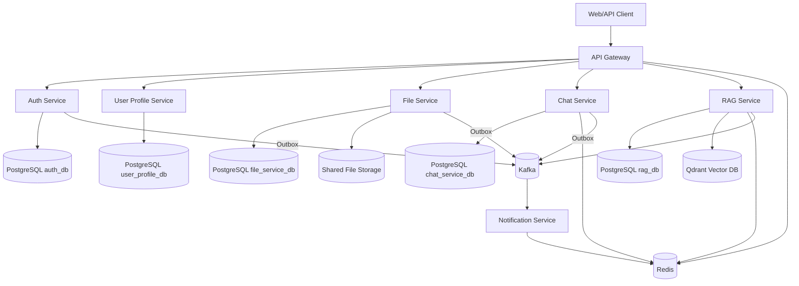

# AI Learning Platform - Backend

## Overview
The AI Learning Platform backend is a microservices system for authentication, user profile management, file lifecycle, conversational chat, AI retrieval-augmented generation (RAG), and asynchronous notifications. It uses gRPC (authenticated with constant-time shared service secrets) for internal synchronous RPCs, Kafka with transactional outboxes and manual offset commits for asynchronous workflows, PostgreSQL for isolated transactional state, Redis (authenticated) for rate limiting, realtime fan-out, and notification deduplication, and Qdrant (API-key protected) for vector retrieval.

## Full System Architecture Diagram

## Services Overview
| Service | Responsibility | Tech | Persistence / Migrations |
| --- | --- | --- | --- |
| `api-gateway` | Public REST/SSE/WS edge, RSA JWT verification + key rotation, `HttpOnly` cookie & CSRF enforcement, rate limiting | Spring Boot WebFlux + Spring Cloud Gateway (HTTP 8080) | Redis (rate limits, streams/pubsub) |
| `auth-service` | Identity, BCrypt auth, RS256 JWT issuance, refresh token rotation, outbox event publishing | Spring Boot 3 + JPA + Flyway + gRPC (HTTP 8082 / gRPC 9090) | PostgreSQL (`auth_db`) via Flyway |
| `user-profile-service` | Profile metadata, visibility, search, idempotent registration bootstrap | Spring Boot 3 + JPA + Flyway + gRPC (HTTP 8083 / gRPC 9091) | PostgreSQL (`user_profile_db`) via Flyway |
| `file-service` | File/folder metadata, sharing ACLs, binary storage, outbox event publishing | Spring Boot 3 + JPA + Flyway + gRPC (HTTP 8084 / gRPC 9092) | PostgreSQL (`file_service_db`) via Flyway + volume |
| `chat-service` | Chatrooms, messages, typing indicators, outbox event publishing, Kafka DLT handling | Spring Boot 3 + JPA + Flyway + gRPC + Kafka + Redis (HTTP 8085 / gRPC 9095) | PostgreSQL (`chat_service_db`) via Flyway + Redis |
| `rag-service` | Multi-format extraction (PDF/DOCX/XLSX/PPTX/images+OCR), Qdrant retrieval, bounded multi-instance execution leases, `MultiFernet` key encryption | FastAPI + gRPC + SQLAlchemy + Alembic + Kafka (HTTP 8087 / gRPC 9097) | PostgreSQL (`rag_db`) via Alembic + Qdrant |
| `notification-service` | Manual-commit Kafka verification email consumer, persistent Redis/SQLite deduplication, confirmed DLQ delivery | FastAPI + Kafka + `smtplib` + Redis (HTTP 8086) | Redis / SQLite deduplication store |
| `proto` | Shared protobuf contracts for all internal gRPC APIs | Protocol Buffers | None |

## Reliability & Event Delivery Patterns
- **Transactional Outbox (`auth-service`, `file-service`, `chat-service`):** Domain events are persisted in `outbox_events` inside the same database transaction as domain writes and dispatched asynchronously by `FOR UPDATE SKIP LOCKED` pollers with synchronous Kafka broker acknowledgments and exponential backoff.
- **Manual Offset Commits & Confirmed DLT (`rag-service`, `notification-service`):** Auto-commit is disabled. Exact per-record offsets are committed only after successful processing or confirmed dead-letter publication.
- **Persistent Notification Deduplication (`notification-service`):** Uses atomic Redis `SET NX EX` (or SQLite fallback for local/single-node setups) to prevent duplicate email sends across restarts and replicas.
- **Multi-Instance AI Execution Leases (`rag-service`):** `DirectExecutionWorker` uses bounded worker concurrency + bounded queue capacity, atomic database claiming (`FOR UPDATE SKIP LOCKED`), periodic lease heartbeats, transient-failure retries with exponential backoff, and stalled-job recovery.
- **Observability:** All services emit structured JSON logs, propagate `X-Correlation-ID` across HTTP/gRPC/Kafka boundaries, expose liveness/readiness probes (`/actuator/health/liveness`, `/actuator/health/readiness`, `/health`, `/ready`), and expose Prometheus metrics (`/actuator/prometheus`, `/metrics`).

## Running & Testing
See the root [README.md](../README.md) and [SECURITY.md](../SECURITY.md) for RSA key generation (`./scripts/generate-dev-keys.sh`), required environment variables, Docker Compose commands, and test suites.
